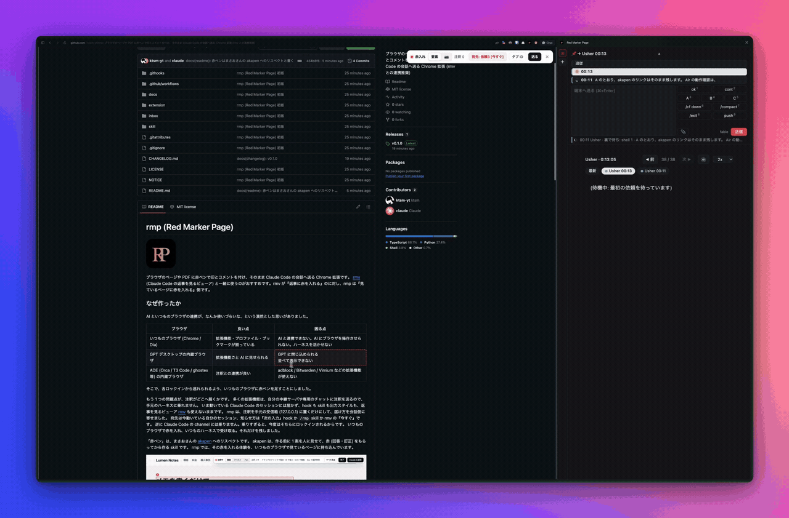
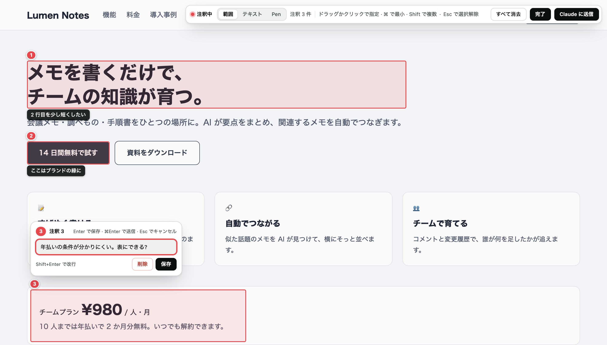
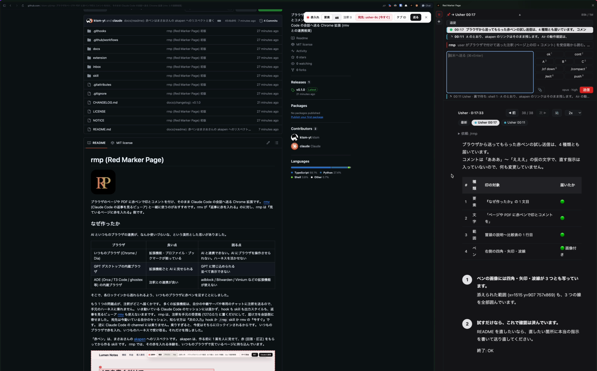
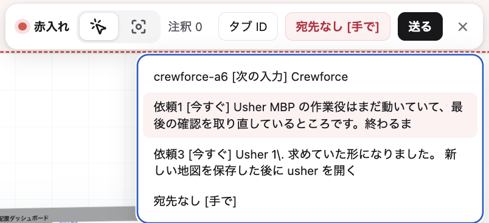
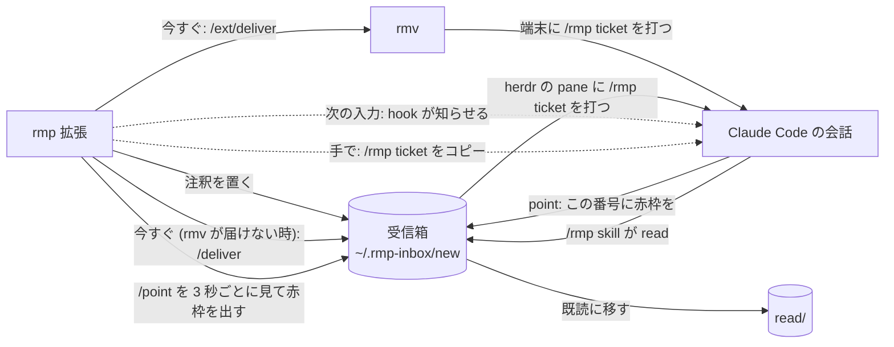

# rmp (Red Marker Page)


ブラウザのページや PDF に赤ペンで印とコメントを付け、そのまま Claude Code の会話へ送る Chrome / Firefox 拡張です。
[rmv](https://github.com/ktsm-yt/rmv) (Claude Code の返事を見るビューア) と一緒に使うのがおすすめです。rmv が『返事に赤を入れる』のに対し、rmp は『見ているページに赤を入れる』側です。
[herdr](https://herdr.dev) の pane で動く Claude Code なら、rmv が無くても、送るとすぐその pane に `/rmp <ticket>` が打ち込まれて会話に届きます (『今すぐ』)。宛先の一覧には pane 名が出て、『次の入力』『手で』も herdr でそのまま使えます。rmv を足すと、返事をサイドパネルで読めます。



[高画質の動画 (mp4)](docs/demo.mp4) (1.5 倍速。操作の一部と待ち時間は省略しています)

## なぜ作ったか

AI といつものブラウザの連携が、なんか使いづらいな、という漠然とした思いがありました。

| ブラウザ | 良い点 | 困る点 |
| --- | --- | --- |
| いつものブラウザ (Chrome / Dia) | 拡張機能・プロファイル・ブックマークが揃っている | AI と連携できない。AI にブラウザを操作させられない。ハーネスを活かせない |
| GPT デスクトップの内蔵ブラウザ | 拡張機能ごと AI に見せられる | GPT に閉じ込められる<br>並べて表示できない |
| ADE (Orca / T3 Code / ghostex 等) の内蔵ブラウザ | 注釈との連携が良い | adblock / Bitwarden / Vimium などの拡張機能が使えない |

そこで、各ロックインから逃れられるよう、いつものブラウザに赤ペンを足すことにしました。

もう 1 つの問題点が、注釈がどこへ届くかです。
多くの拡張機能は、自分の中継サーバや専用のチャットに注釈を送るので、手元のハーネスに乗れません。
いま動いている Claude Code のセッションには届かず、hook も skill も出力スタイルも、返事を見るビューア [rmv](https://github.com/ktsm-yt/rmv) も使えないままです。
rmp は、注釈を手元の受信箱 (127.0.0.1) に置くだけにして、届け方を会話側に寄せました。
宛先は今動いている自分のセッション、知らせ方は『次の入力』hook か `/rmp` skill か『今すぐ』(rmv か、herdr の pane へ受信箱が直接打つ) です。
逆に Claude Code の channel には乗りません。乗りすぎると、今度はそちらにロックインされるからです。
いつものブラウザで赤を入れ、いつものハーネスで受け取る。それだけを残しました。

「赤ペン」は、まさおさんの [akapen](https://github.com/AI-Driven-R-D-Dept/akapen) へのリスペクトです。
akapen は、作る前に 1 案を人に見せて、赤 (回答・訂正) をもらってから作る skill です。
rmp では、その赤を入れる体験を、いつものブラウザで見ているページに持ち込んでいます。



## 入れる

macOS 前提です。Claude Code を使います。

### Claude Code に入れてもらう (おすすめ)

Claude Code を開き、次の文をそのまま貼ってください。
ターミナルの作業と設定は Claude Code がやります。あなたが手で行うのは、最後のブラウザでの読み込みだけです。

```text
rmp (https://github.com/ktsm-yt/rmp) を入れて。手順は次のとおり。
1. ~/rmp に git clone する (もうあれば git pull)。
2. bash ~/rmp/inbox/install.sh を実行する。
3. 表示された hook の JSON を ~/.claude/settings.json の "hooks" に足す。先にファイルを ~/.claude/settings.json.bak に写し、今ある設定は消さずに配列へ並べる。
4. https://github.com/ktsm-yt/rmp/releases/latest/download/rmp-chrome.zip を落とし、~/rmp/extension/dist に展開する (manifest.json が dist の直下に来るように)。
5. rmv を入れていれば、rmv の README『rmp とつなぐ』のとおり rmv の state/env に 1 行足して rmv を再起動する。入れていなければ飛ばす。
6. 最後に、Chrome で拡張を読み込む手順を私に 1 手ずつ案内する。読み込むフォルダは ~/rmp/extension/dist。Firefox / Zen を使うと私が言ったら、rmp の README『Firefox / Zen に入れる』の手順を代わりに案内する。
途中でエラーが出たら、直そうとする前に何が起きたかを教えて。
```

Claude Code が最後に案内するブラウザでの操作は、次の 3 つです。

1. Chrome 系ブラウザで `chrome://extensions` を開き、デベロッパーモードを ON にする。
2. 『パッケージ化されていない拡張機能を読み込む』で `~/rmp/extension/dist` を選ぶ。
3. PDF に赤を入れるなら、拡張の詳細で『ファイルの URL へのアクセスを許可する』を ON にする。

`git` や `python3` を初めて使う Mac では、途中で『コマンドライン・デベロッパ・ツール』を入れるか聞かれます。『インストール』を押し、終わったら Claude Code に「続けて」と伝えてください。

### 手で入れる

Node.js 22.12 以降と npm、Python 3.9 以降 (`/usr/bin/python3`) を使います。Node.js を使わない場合は、`npm` の行の代わりに [Releases](https://github.com/ktsm-yt/rmp/releases) の `rmp-chrome.zip` を `extension/dist` に展開します。

```sh
git clone https://github.com/ktsm-yt/rmp.git
cd rmp
bash inbox/install.sh          # 受信箱 (127.0.0.1:8766 の常駐) と /rmp skill を入れる
cd extension && npm ci && npm run build
```

ブラウザでの読み込み方は上の『Claude Code に入れてもらう』の 1〜3 と同じです (選ぶフォルダは clone した場所の `extension/dist`)。

`install.sh` の最後に、Claude Code の hook の設定 (任意) が表示されます。`~/.claude/settings.json` に貼ると、送った注釈が次の入力で会話に届きます。スクリプトは settings.json を書き換えません。

外すときは `bash inbox/install.sh uninstall`。受け取った注釈 (`~/.rmp-inbox`) は残ります。

拡張の ID は manifest の `key` (公開鍵) で `kgdkanfbaiakfcncpfdllehhenoplheg` に固定され、受信箱はこの ID からの送信だけを受けます。

権限は `activeTab`、`scripting`、`storage`、`sidePanel`。通信先は手元の `127.0.0.1:8766` (受信箱) と `127.0.0.1:4310` (rmv) だけです。

### Firefox / Zen に入れる

Firefox 140 以降 (Zen など Firefox 系を含む) は、Mozilla の署名を受けた `.xpi` を入れます。ストアには公開していません。

1. [Releases](https://github.com/ktsm-yt/rmp/releases) から最新の `red-marker-page-<版>.xpi` を落とす。
2. ブラウザの窓へドラッグ＆ドロップするか、`about:addons` の歯車 →『ファイルからアドオンをインストール』で選ぶ。
3. `about:config` の `extensions.webextensions.uuids` で、`red-marker-page@ktsm-yt.github.io` の値を `e9f3dda0-0bd4-4cb6-b23c-243a430e4c3c` にしてブラウザを再起動する。

3 は拡張の送り元を固定するためです。Firefox は送り元 (`moz-extension://<UUID>`) をプロファイルごとにランダムに決めるので、固定しないと受信箱が 403 で断ります。別の UUID を使う時は、受信箱の `RMP_INBOX_ORIGINS` に `chrome-extension://kgdkanfbaiakfcncpfdllehhenoplheg,moz-extension://<UUID>` を渡します (断った送り元は受信箱のログに出ます)。

rmv は Firefox ではサイドバーに開きます (`⌘⇧,`)。キーは `about:addons` の歯車 →『拡張機能のショートカットキーを管理』で変えられます。新しい版は自動で入ります (Firefox が 1 日 1 回 Releases の `updates.json` を見に行きます。すぐ確かめる時は `about:addons` の歯車 →『更新を確認』)。
v0.1.8 以前を入れている人は、1〜2 の手順で最新の xpi を 1 回だけ上から入れ直してください (確かめ先は v0.1.9 から入れたので、それより前の版は自分では上がりません。3 の設定は残ります)。

版を出す人向け: `v<版>` のタグを push した後に次を叩くと、Mozilla の非公開署名 (人の審査を待たず数分で済む) を受けて、その版の Release に `red-marker-page-<版>.xpi` と `updates.json` を添付します。AMO の API キーはキーチェーンの `amo-jwt-issuer` / `amo-jwt-secret` から読みます。

```sh
cd extension && npm run release:firefox
```

### rmv と連携する

[rmv](https://github.com/ktsm-yt/rmv) は無くても動きますが、一緒に使うのがおすすめです。入れていると、herdr 以外の端末 (Orca) でも送った注釈を『今すぐ』会話へ打ち込めて、rmv をサイドパネルで開けます。
サイドパネルには、いま動いている全部の Claude Code のセッションが並ぶので、ブラウザから離れずにどの agent の返事も見られ、宛先も選べます。
赤を入れる → 直る → 返事を見る → また赤を入れる、が 1 画面で回ります。



『今すぐ』を使うには、rmv の `state/env` に次の 1 行を書いて rmv を再起動します ([rmv の『外部ツールとつなぐ』](https://github.com/ktsm-yt/rmv#外部ツールとつなぐ))。

```sh
RMV_EXT_ORIGINS=chrome-extension://kgdkanfbaiakfcncpfdllehhenoplheg
```

Firefox / Zen から使う時は、カンマで続けて `moz-extension://e9f3dda0-0bd4-4cb6-b23c-243a430e4c3c` も足します。

## 赤入れする

拡張のボタン、または `⌘⇧.` (Mac 以外は `Ctrl+Shift+.`) で注釈モードを出し入れします。rmv のサイドパネルは `⌘⇧,` (Mac 以外は `Ctrl+Shift+,`) で開閉します。引っ込めている間はページを普通に操作でき、もう一度出すと送る前の注釈がそのまま戻ります (同じページにいる間だけ。再読み込みや別のページへの移動で消えます)。キーは `chrome://extensions/shortcuts` で変更できます。『タブ ID』は同画面で自分で割り当てるか、ツールバーの『タブ ID』ボタンを使います。

| 操作 | 動作 |
|---|---|
| クリック | 要素に注釈を付け、コメント欄を開く |
| ⌘ + クリック | 重なった要素のうち小さいものを選ぶ |
| Shift + クリック | 複数の注釈を選び、同じコメントを付ける |
| 欄外で Tab | 要素 (矢印のアイコン) ⇄ 撮影 (四隅のアイコン) を切り替える |
| 要素モードで文字の上からドラッグ | なぞった文字に注釈を付ける |
| 要素モードで余白から、または ⌥ を押してドラッグ | 赤い矩形を付ける (離すと要素モードのまま) |
| 撮影で描く | 押した時の画面が止まり、その上に四角・矢印・手描き (3 色) を何個でも描く。Enter / ✓ で描いた所を 1 枚の画像付きの注釈にする。何も描かずに Enter なら画面全体の注釈。⌘Z / 戻すのアイコン で 1 つ戻す、Esc / × で描きかけを消す (何も無ければ要素モードへ)。各モードの操作はモードのボタンに指を置くと出る。ペンの道具バーは画面の中央下に出る。メインバーと道具バーは、ボタン以外の所をドラッグすると動かせる |
| コメント欄で Enter | コメントを保存する |
| ⌘Enter / 『送る』 | 書きかけのコメントを保存し、全部送る |
| 『タブ ID』 | 送信前の下書きを読むための ID をコピーする |
| 右端の × | 注釈と下書きを消して注釈モードを閉じる |

### Claude に場所を示してもらう

送るたびに、そのページの見出し・リンク・ボタン・入力欄の文字に番号を振った一覧 (部品一覧) も一緒に届きます。スクロールした先の部品も入ります (先頭から 300 個まで。入力欄に打った中身は送りません)。
「この設定どこ?」のように場所を聞くと、Claude が一覧から番号を選んで `rmp-inbox.py point` で返し、ページのその部品に赤枠が出て、そこまでスクロールします。赤枠はその部品を押すか、枠の札の × を押すまで残ります。
赤枠が出るのは、送ったタブが同じページを開いたままの時で、送ってから 30 分までです (注釈モードを引っ込めていても出ます)。PDF には一覧を付けません。
一覧の大きさは、2026-11-17 に 7 ページで測って 12〜300 個、`/rmp` で読む文字数で 300〜13,000 字ほどでした。

日本語の変換中の Enter は保存・送信に使いません。描き終わっただけでは送信しません。再読み込み後に注釈を復元する機能はありません。

『宛先』の一覧で行を選ぶと、宛先だけを決めます。送るのは ⌘Enter か『送る』です (宛先を決めずに送って一覧が出た時だけは、選ぶとそのまま送ります)。送信後は、rmv か受信箱 (herdr の pane) が打ち込む『今すぐ』、hook で『次の入力』、コピーした `/rmp <ticket>` を自分で貼る『手で』のいずれかで会話へ知らせます。宛先の入力欄に書きかけがある時や、許可・質問の返事を待っている時は打ち込まず、『手で』に回します。会話で `/rmp` による読み取りが実行されて既読になると、ページに『読まれた』と出ます。

一覧の 1 行は『名前 [知らせ方] フォルダ 最新の返事の書き出し』です。
名前には herdr の pane 名 (rmv が無くても出ます)、フォルダにはそのセッションの作業 dir の名前が出るので、同じ repo で並べた会話も見分けられます。最新の返事の書き出しは rmv がある時だけ出ます。



### PDF に赤入れする

仕様書・論文・請求書など、ページではなく PDF に赤を入れて会話へ送れます。
PDF のタブで注釈を起動すると、拡張に同梱した pdf.js の viewer (Firefox と同じもの。拡大縮小・ページ送り・検索・目次付き) が開きます。URL から取得できない PDF は viewer の『ファイルを開く』から選ぶか、ファイルをドラッグ＆ドロップします。範囲印と撮影には、見えているページと赤枠を合成した JPEG を付けます。pdf.js を更新する時は `extension/scripts/vendor-pdfjs.sh <版>` を叩きます。

## 送った注釈を読む

送った注釈は受信箱に溜まり、会話へは 3 本のどれかで届きます。



会話で `/rmp` と打つと、自分宛ての注釈を読みます。送信後に出る `/rmp <ticket>` を貼ると、その 1 件だけを読みます。
手で読むときは次のコマンドです。

```sh
python3 inbox/rmp-inbox.py read --ticket 20261025-223344-123456
python3 inbox/rmp-inbox.py read --session <自分のセッションID>
python3 inbox/rmp-inbox.py read --draft <タブID>
python3 inbox/rmp-inbox.py point 20261025-223344-123456 12   # 部品一覧の 12 番に赤枠を出す
```

送った注釈を読むと `new/` から `read/` に移ります。下書きの `read --draft` は表示だけで、既読にしません。

## 試験を実行する

repo のルートで実行します。

```sh
python3 -m unittest inbox/test_rmp_inbox.py
cd extension
npm ci
npx playwright install chromium   # e2e 用のブラウザ (初回だけ)
npm run build
npm run build:test                # 単体試験が試験用ビルドの manifest も見るため
npm run test
npm run typecheck
npm run e2e
```

E2E は実拡張、実受信箱、模擬 rmv、偽セッションを使い、ポート・HOME・ブラウザのプロファイルを隔離します。ヘッドレスのため、注釈の起動は CDP の `Extensions.triggerAction` を使います。製品のショートカット自体の動作確認にはなりません。

スクリーンショットと生ログは `extension/e2e-results/` に保存し、Git には入れません。デモは通常試験から外し、`DEMO_NARRATE=1 npx playwright test e2e/demo` で録画します。`scripts/e2e-demo-video.sh <録画の出力ディレクトリ> e2e-results/demo.mp4` で `say` と ffmpeg の音声を重ねます。

## ライセンス

MIT ([LICENSE](LICENSE))。同梱の pdf.js は Apache-2.0 ([NOTICE](NOTICE))。
