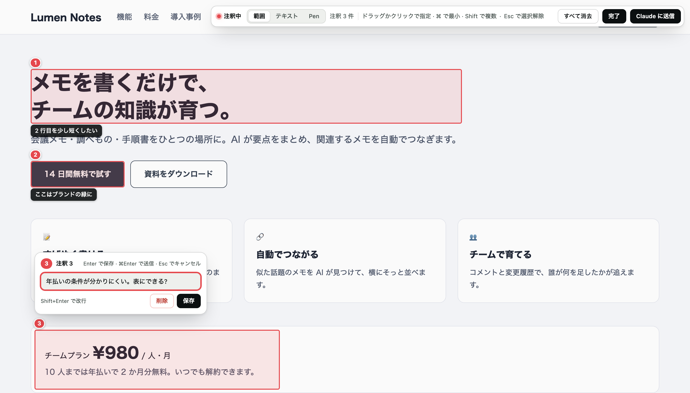
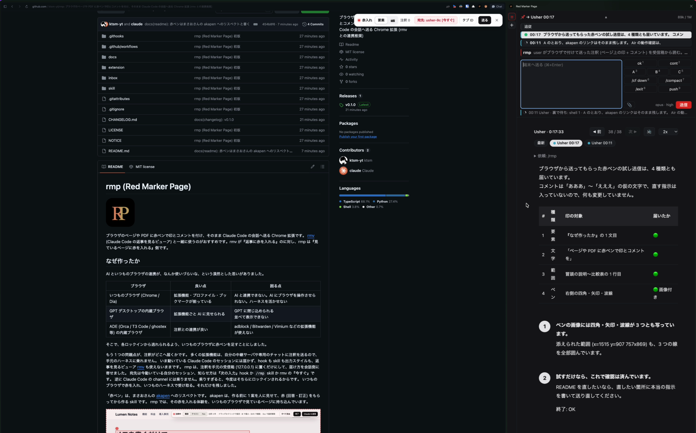
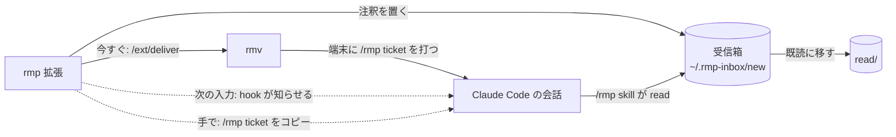

# rmp (Red Marker Page)


ブラウザのページや PDF に赤ペンで印とコメントを付け、そのまま Claude Code の会話へ送る Chrome 拡張です。
[rmv](https://github.com/ktsm-yt/rmv) (Claude Code の返事を見るビューア) と一緒に使うのがおすすめです。rmv が『返事に赤を入れる』のに対し、rmp は『見ているページに赤を入れる』側です。

## なぜ作ったか

AI といつものブラウザの連携が、なんか使いづらいな、という漠然とした思いがありました。

| ブラウザ | 良い点 | 困る点 |
| --- | --- | --- |
| いつものブラウザ (Chrome / Dia) | 拡張機能・プロファイル・ブックマークが揃っている | AI と連携できない。AI にブラウザを操作させられない。ハーネスを活かせない |
| GPT デスクトップの内蔵ブラウザ | 拡張機能ごと AI に見せられる | GPT に閉じ込められる<br>並べて表示できない |
| ADE (Orca / T3 Code / ghostex 等) の内蔵ブラウザ | 注釈との連携が良い | adblock / Bitwarden / Vimium などの拡張機能が使えない |

そこで、各ロックインから逃れられるよう、いつものブラウザに赤ペンを足すことにしました。

もう 1 つの問題点が、注釈がどこへ届くかです。
多くの拡張機能は、自分の中継サーバや専用のチャットに注釈を送るので、手元のハーネスに乗れません。
いま動いている Claude Code のセッションには届かず、hook も skill も出力スタイルも、返事を見るビューア [rmv](https://github.com/ktsm-yt/rmv) も使えないままです。
rmp は、注釈を手元の受信箱 (127.0.0.1) に置くだけにして、届け方を会話側に寄せました。
宛先は今動いている自分のセッション、知らせ方は『次の入力』hook か `/rmp` skill か rmv の『今すぐ』です。
逆に Claude Code の channel には乗りません。乗りすぎると、今度はそちらにロックインされるからです。
いつものブラウザで赤を入れ、いつものハーネスで受け取る。それだけを残しました。

「赤ペン」は、まさおさんの [akapen](https://github.com/AI-Driven-R-D-Dept/akapen) へのリスペクトです。
akapen は、作る前に 1 案を人に見せて、赤 (回答・訂正) をもらってから作る skill です。
rmp では、その赤を入れる体験を、いつものブラウザで見ているページに持ち込んでいます。



## 入れる

macOS 前提です。Node.js 22.12 以降と npm、Python 3.9 以降 (`/usr/bin/python3`)、Claude Code を使います。

```sh
git clone https://github.com/ktsm-yt/rmp.git
cd rmp
bash inbox/install.sh          # 受信箱 (127.0.0.1:8766 の常駐) と /rmp skill を入れる
cd extension && npm ci && npm run build
```

1. Chrome 系ブラウザで `chrome://extensions` を開き、デベロッパーモードを ON にする。
2. 『パッケージ化されていない拡張機能を読み込む』で `extension/dist` を選ぶ。
3. PDF に赤を入れるなら、拡張の詳細で『ファイルの URL へのアクセスを許可する』を ON にする。

`install.sh` の最後に、Claude Code の hook の設定 (任意) が表示されます。`~/.claude/settings.json` に貼ると、送った注釈が次の入力で会話に届きます。スクリプトは settings.json を書き換えません。

外すときは `bash inbox/install.sh uninstall`。受け取った注釈 (`~/.rmp-inbox`) は残ります。

拡張の ID は manifest の `key` (公開鍵) で `kgdkanfbaiakfcncpfdllehhenoplheg` に固定され、受信箱はこの ID からの送信だけを受けます。

権限は `activeTab`、`scripting`、`storage`、`sidePanel`。通信先は手元の `127.0.0.1:8766` (受信箱) と `127.0.0.1:4310` (rmv) だけです。

### rmv と連携する

[rmv](https://github.com/ktsm-yt/rmv) は無くても動きますが、一緒に使うのがおすすめです。入れていると、送った注釈を『今すぐ』会話へ打ち込めて、rmv をサイドパネルで開けます。
サイドパネルには、いま動いている全部の Claude Code のセッションが並ぶので、ブラウザから離れずにどの agent の返事も見られ、宛先も選べます。
赤を入れる → 直る → 返事を見る → また赤を入れる、が 1 画面で回ります。



『今すぐ』を使うには、rmv の `state/env` に次の 1 行を書いて rmv を再起動します ([rmv の『外部ツールとつなぐ』](https://github.com/ktsm-yt/rmv#外部ツールとつなぐ))。

```sh
RMV_EXT_ORIGINS=chrome-extension://kgdkanfbaiakfcncpfdllehhenoplheg
```

## 赤入れする

拡張のボタン、または `⌘⇧.` (Mac 以外は `Ctrl+Shift+.`) で注釈モードを出し入れします。rmv のサイドパネルは `⌘⇧,` (Mac 以外は `Ctrl+Shift+,`) で開閉します。引っ込めている間はページを普通に操作でき、もう一度出すと送る前の注釈がそのまま戻ります (同じページにいる間だけ。再読み込みや別のページへの移動で消えます)。キーは `chrome://extensions/shortcuts` で変更できます。『タブ ID』は同画面で自分で割り当てるか、ツールバーの『タブ ID』ボタンを使います。

| 操作 | 動作 |
|---|---|
| クリック | 要素に注釈を付け、コメント欄を開く |
| ⌘ + クリック | 重なった要素のうち小さいものを選ぶ |
| Shift + クリック | 複数の注釈を選び、同じコメントを付ける |
| 欄外で Tab | 要素 ⇄ 📷 (撮影) を切り替える |
| 要素モードで文字の上からドラッグ | なぞった文字に注釈を付ける |
| 要素モードで余白から、または ⌥ を押してドラッグ | 赤い矩形を付ける (離すと要素モードのまま) |
| 📷 で描く | 押した時の画面が止まり、その上に四角・矢印・手描き (3 色) を何個でも描く。Enter / ✓ で描いた所を 1 枚の画像付きの注釈にする。何も描かずに Enter なら画面全体の注釈。⌘Z / 戻すのアイコン で 1 つ戻す、Esc / × で描きかけを消す (何も無ければ要素モードへ)。各モードの操作はモードのボタンに指を置くと出る。ペンの道具バーは画面の中央下に出る。メインバーと道具バーは、ボタン以外の所をドラッグすると動かせる |
| コメント欄で Enter | コメントを保存する |
| ⌘Enter / 『送る』 | 書きかけのコメントを保存し、全部送る |
| 『タブ ID』 | 送信前の下書きを読むための ID をコピーする |
| 右端の × | 注釈と下書きを消して注釈モードを閉じる |

日本語の変換中の Enter は保存・送信に使いません。描き終わっただけでは送信しません。再読み込み後に注釈を復元する機能はありません。

『宛先』の一覧で行を選ぶと、注釈があればその宛先へ送ります。注釈がなければ宛先だけを決めます。送信後は、rmv で『今すぐ』、hook で『次の入力』、コピーした `/rmp <ticket>` を自分で貼る『手で』のいずれかで会話へ知らせます。会話で `/rmp` による読み取りが実行されて既読になると、ページに『読まれた』と出ます。

### PDF に赤入れする

仕様書・論文・請求書など、ページではなく PDF に赤を入れて会話へ送れます。
PDF のタブで注釈を起動すると、拡張に同梱した pdf.js の viewer (Firefox と同じもの。拡大縮小・ページ送り・検索・目次付き) が開きます。URL から取得できない PDF は viewer の『ファイルを開く』から選ぶか、ファイルをドラッグ＆ドロップします。範囲印と撮影には、見えているページと赤枠を合成した JPEG を付けます。pdf.js を更新する時は `extension/scripts/vendor-pdfjs.sh <版>` を叩きます。

## 送った注釈を読む

送った注釈は受信箱に溜まり、会話へは 3 本のどれかで届きます。



会話で `/rmp` と打つと、自分宛ての注釈を読みます。送信後に出る `/rmp <ticket>` を貼ると、その 1 件だけを読みます。
手で読むときは次のコマンドです。

```sh
python3 inbox/rmp-inbox.py read --ticket 20261025-223344-123456
python3 inbox/rmp-inbox.py read --session <自分のセッションID>
python3 inbox/rmp-inbox.py read --draft <タブID>
```

送った注釈を読むと `new/` から `read/` に移ります。下書きの `read --draft` は表示だけで、既読にしません。

## 試験を実行する

repo のルートで実行します。

```sh
python3 -m unittest inbox/test_rmp_inbox.py
cd extension
npm ci
npx playwright install chromium   # e2e 用のブラウザ (初回だけ)
npm run build
npm run build:test                # 単体試験が試験用ビルドの manifest も見るため
npm run test
npm run typecheck
npm run e2e
```

E2E は実拡張、実受信箱、模擬 rmv、偽セッションを使い、ポート・HOME・ブラウザのプロファイルを隔離します。ヘッドレスのため、注釈の起動は CDP の `Extensions.triggerAction` を使います。製品のショートカット自体の動作確認にはなりません。

スクリーンショットと生ログは `extension/e2e-results/` に保存し、Git には入れません。デモは通常試験から外し、`DEMO_NARRATE=1 npx playwright test e2e/demo` で録画します。`scripts/e2e-demo-video.sh <録画の出力ディレクトリ> e2e-results/demo.mp4` で `say` と ffmpeg の音声を重ねます。

## ライセンス

MIT ([LICENSE](LICENSE))。同梱の pdf.js は Apache-2.0 ([NOTICE](NOTICE))。
